<p align="center">
  
</p>

<p align="center">
  <b>Market traders can't net their debts through a bank. Alamino clears them instead.</b><br>
  Capture debts with AI, clear the circles, settle the rest with PayPal.
</p>

<p align="center">
  <a href="https://readme-typing-svg.herokuapp.com/?font=Inter&size=21&center=true&vCenter=true&color=0070E0&lines=Snap+a+notebook.+AI+drafts+the+debt.;Circles+cancel.+No+money+moves.;PayPal+settles+what+is+left."></a>
</p>

<p align="center">
  
  
  
  
  
  
</p>

<p align="center">
  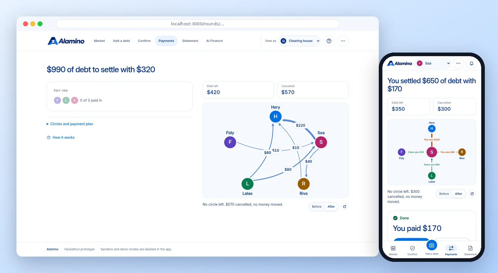
</p>

<p align="center">
  <a href="#try-it-in-2-minutes">🚀 Try it</a> ·
  <a href="#the-problem">Problem</a> ·
  <a href="#see-it-move">Demo</a> ·
  <a href="#how-the-clearing-works">Clearing</a> ·
  <a href="#paypal">PayPal</a> ·
  <a href="#ai">AI</a> ·
  <a href="#screens">Screens</a> ·
  <a href="#environment-variables">Env vars</a> ·
  <a href="#contributors">Contributors</a> ·
  <a href="#docs">Docs</a>
</p>

## The problem

In a market, traders owe each other all day: the butcher owes the rice seller, the rice seller owes the restaurant, the restaurant owes the butcher. Debts are written in notebooks, and each trader settles every one of them by hand, in cash or by transfer. A bank does not net these debts, so far more money moves than needs to.

Alamino finds the debts that form circles and cancels them, so no money moves for those. It then settles only what is left: each trader pays once or is paid once.

In the demo market, **$990 of debt is settled by moving $320**, a cash saving of 67.7%.

## Try it in 2 minutes

**Hosted demo: [alamino.live-preprod.site](https://alamino.live-preprod.site).** No account is needed for the labelled simulated payment flow. The hosted demo currently uses AI fallback; photo understanding with a model requires an AI key. For real Sandbox payments, follow the [Finance setup](docs/FINANCE.md), use sandbox accounts and sign in as the operator. Never use real PayPal credentials to try this demo.

No keys needed. Without PayPal keys, payments run in labelled simulated mode. Without an AI key, capture and statements use a labelled plain-code fallback.

```sh
git clone https://github.com/donovan-ratefison/alamino.git && cd alamino
npm ci
cp .env.example .env.local
npm run dev
```

Open http://localhost:3000. The app seeds five traders and eight confirmed debts when the database is empty. Adding and confirming the $50 debt below produces the nine-debt, $990 example. Node 22.13 or later; CI and the VPS use Node 24.21.0, also pinned in [.nvmrc](.nvmrc).

**Tour in 5 minutes, with no keys:**

1. **See the market** on `/` as Rivo (use the "View as" switcher in the header).
2. **Add a debt** on `/add`: type "I owe Hery 50 for rice", click Read, save.
3. **Approve it**: switch to Hery, approve on `/confirm`.
4. **Clear it**: switch to **Clearing house**, return to `/` and click Run clearing. Watch the circles cancel.
5. **Settle it**: switch to Soa, Lalao and Fidy to make each simulated pay-in. Switch back to **Clearing house** to send payouts, then select a trader and read `/statement`.

The first visit also opens a short guided tour. The reset button on the market screen replays the demo from the start.

## See it move

Every clip below is a real recording of the app running on its seed data, with no keys: simulated PayPal and the plain-code AI fallback. The five steps follow one debt from a sentence to a statement.

### 1. Add: a sentence or a photo becomes a draft

Rivo types "I owe Hery 50 for rice". The AI turns it into an editable draft card: who owes whom, how much, for what. Nothing is saved until Rivo checks it and clicks save. A photo of a notebook page works the same way, with one draft per line.

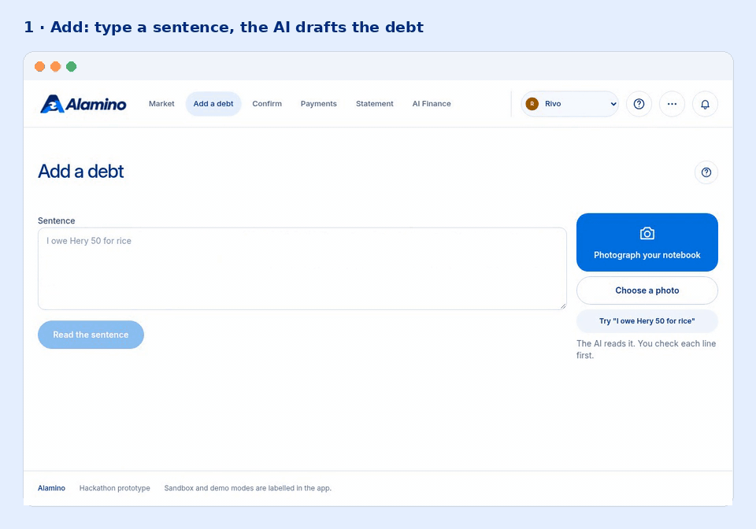

### 2. Confirm: both sides must agree

The debt waits in Hery's queue as "Rivo owes you". Hery approves, or counters with another amount. If the two amounts differ, the AI proposes a fix, and both sides still approve it.

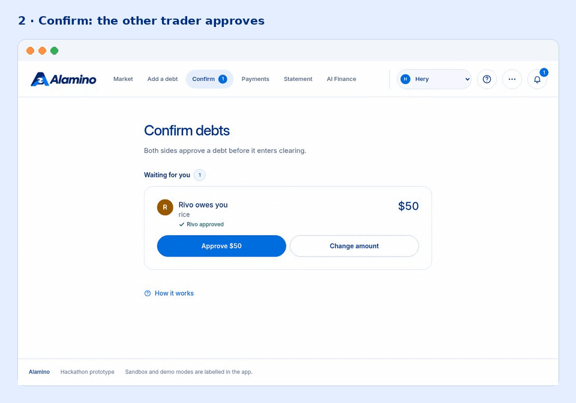

### 3. Clear: circles cancel, no money moves

With nine confirmed debts, the clearing house runs the round. The screen replays the cancellation on the debt network: first the circle, for example Fidy → Rivo → Hery → Fidy with $40 off each debt, then the next ones. **Before** and **After** show the network on both sides of the clearing. Here $570 is cancelled and $420 of debt is left.

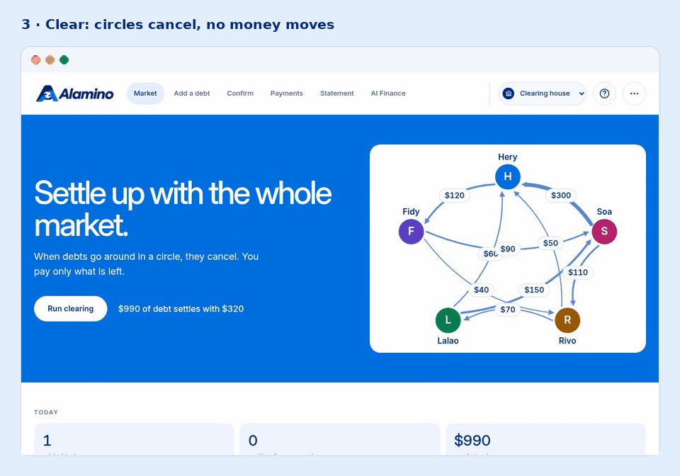

### 4. Settle: pay in, then one payout batch

Each trader who still owes pays their amount once through PayPal Checkout (Soa $170, Lalao $140, Fidy $10). When all three pay-ins are captured, the house sends one PayPal Payouts batch to the traders who are owed (Hery $290, Rivo $30). The round turns to done.

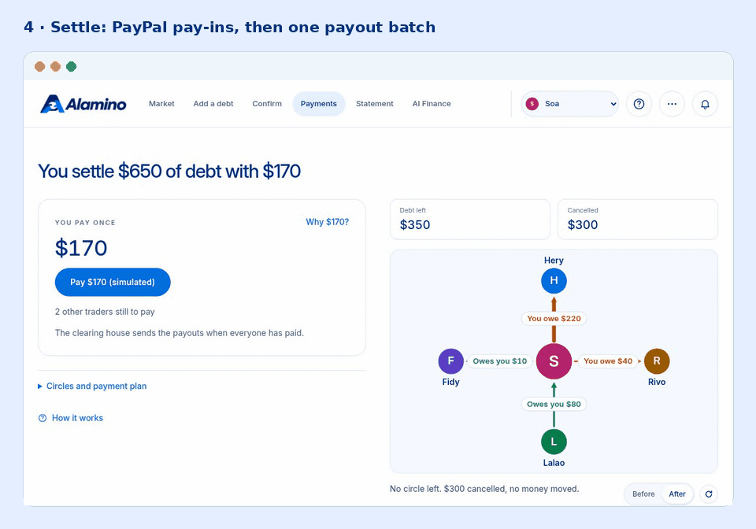

### 5. Explain: a statement for every trader

Each trader gets a plain-language statement: what cancelled, what is left, and why. Soa reads "you pay $170", Hery reads "you receive $290". The amounts come from the engine, and the AI writes only the words.

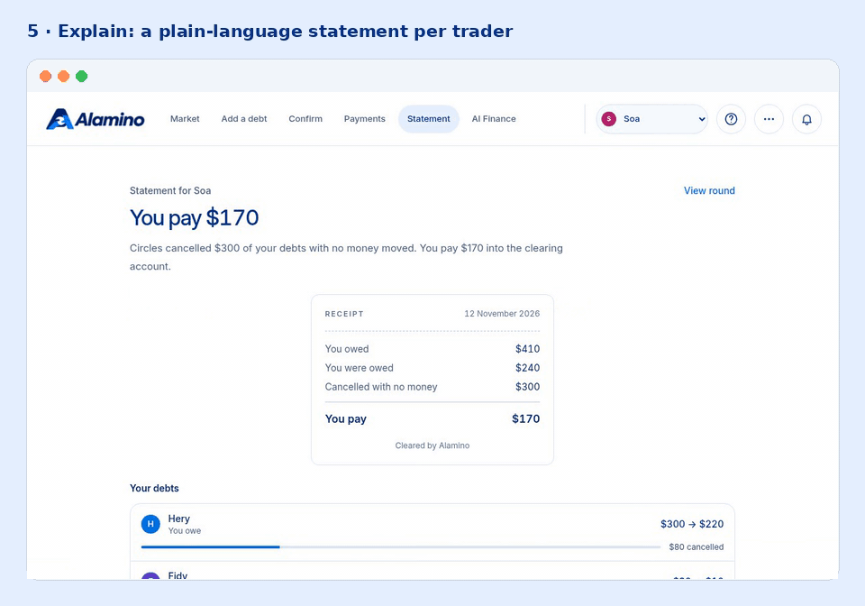

### On a phone

The same path works on a phone. The camera comes first on **Add**, because a trader's notebook is the usual starting point, and the sentence field opens on demand. A bottom bar keeps the five destinations in reach.

<p align="center">
  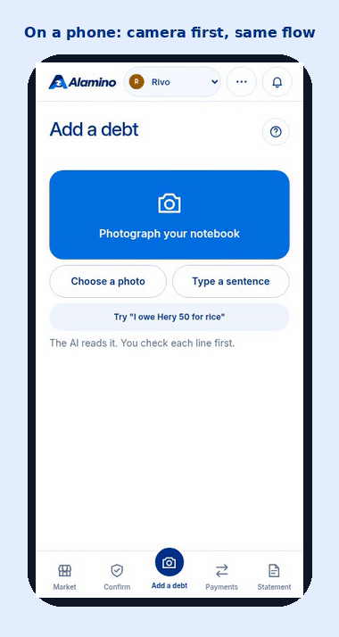
</p>

<p align="center">
  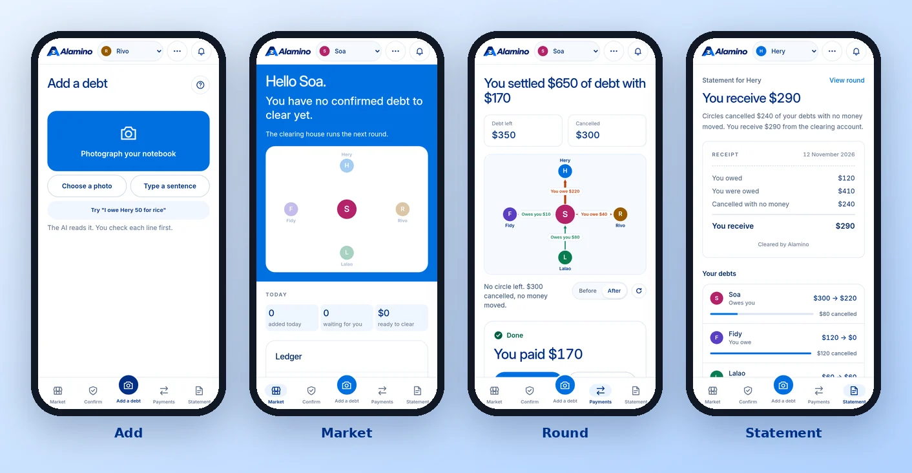
</p>

## How it works

| | Step |
|---|---|
|  | **1. Add.** A trader types a sentence or photographs a notebook page. The AI turns it into a draft debt. |
|  | **2. Confirm.** Debtor and creditor both approve. If their amounts differ, the AI proposes a fix. |
|  | **3. Clear.** The engine cancels the debts that form circles. No money moves. |
|  | **4. Settle.** Traders who still owe pay in through PayPal Checkout. PayPal Payouts pays the traders who are owed. |
|  | **5. Explain.** Each trader gets a plain-language statement of what cancelled, what is left and why. |

> The AI never computes or changes an amount. Money math is plain, tested code.

## How the clearing works

A confirmed debt is an arrow from the debtor to the creditor. When arrows form a loop, each debt in the loop can be reduced by the smallest amount in it, and nobody is worse off.

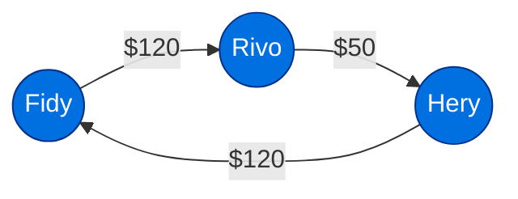

*A simplified circle: the smallest debt in the loop is $50, so each of the three debts drops by $50. Rivo's debt disappears, and no money moves for those $150.*

The round then works in three phases:

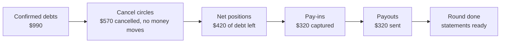

Why $420 of debt becomes $320 of money: after the circles cancel, each trader has one net position. Traders who owe more than they are owed pay in once; the others are paid once, so the pay-ins equal the payouts.

## The demo numbers

Five traders: Hery (rice), Soa (restaurant), Rivo (butcher), Lalao (vegetables), Fidy (delivery).

| | Amount |
|---|---|
| Total debts | $990 |
| Cancelled by circles, no money moved | $570 |
| Paid through PayPal | $320 |
| Cash saved | 67.7% |

Pay-ins: Soa $170, Lalao $140, Fidy $10. Pay-outs: Hery $290, Rivo $30.

## PayPal

One sandbox business account is the clearing account. Each trader has a sandbox personal account.

**Pay-in (Orders v2):** the trader clicks the PayPal button on the round page. The server creates an order for exactly that trader's pay-in amount, the trader approves in the PayPal popup, and the server captures it and checks the captured amount equals the plan.

**Pay-out (Payouts):** when every pay-in is captured, the server sends one payout batch with one item per trader who is owed. `sender_batch_id` is the round id, so a retry cannot pay twice. The server polls the batch, then marks debts `settled` and the round `done`.

**Rules:** the server never trusts an amount from the browser. Capture and payout are idempotent. No payout runs before all pay-ins are captured. PayPal does not support MGA, so the demo uses integer cents in USD.

Without `PAYPAL_CLIENT_ID` and `PAYPAL_CLIENT_SECRET`, payments run in simulated mode and the UI says so, as in the clips above ("Pay $170 (simulated)").

## AI

The app calls one vision LLM through the OpenAI Chat Completions format. Any OpenAI-compatible provider works. The model must support images and strict structured output. Every call asks for strict JSON and the result is validated before use.

| Function | Input | Output |
|---|---|---|
| `captureDebts` | text or photo, trader list, who is speaking | `DebtDraft[]`, or a question when something is unknown |
| `resolveMismatch` | the debt, both claimed amounts, both notes | a suggestion and a proposed amount (both sides must still approve) |
| `explainRound` | one trader's debts before and after, cancellations, net position | a plain-language statement (amounts come from the engine, the AI writes only words) |

Without `AI_API_KEY`, capture and statements use a plain-code fallback and the UI says so (the "No AI: check each line" tag in the Add clip). `AI_REASONING_EFFORT=minimal` reads a notebook photo about 3 times faster with the same result in our tests. `AI_DAILY_CALLS` caps model calls per day to protect a public demo key.

## Stack

<p>
  <a href="https://skillicons.dev"></a>
</p>

| Piece | Choice |
|---|---|
| App | Next.js 16 (App Router), TypeScript, Tailwind CSS |
| Database | Persistent SQLite via `better-sqlite3`; seeded only when empty, or explicitly reset for the demo |
| AI | One multimodal LLM, called only from `src/lib/ai/` |
| PayPal | Orders v2 (pay-in) and Payouts (pay-out), sandbox |
| Debt network view | React Flow |
| Ledger table | AG Grid (+ AG Studio on `/finance`) |
| First-visit tour | Driver.js |

## Screens

Real screenshots of the running app, on the demo data.

### Market (`/`)

The debt network, the ledger, the headline numbers, **Run clearing** and the reset button.

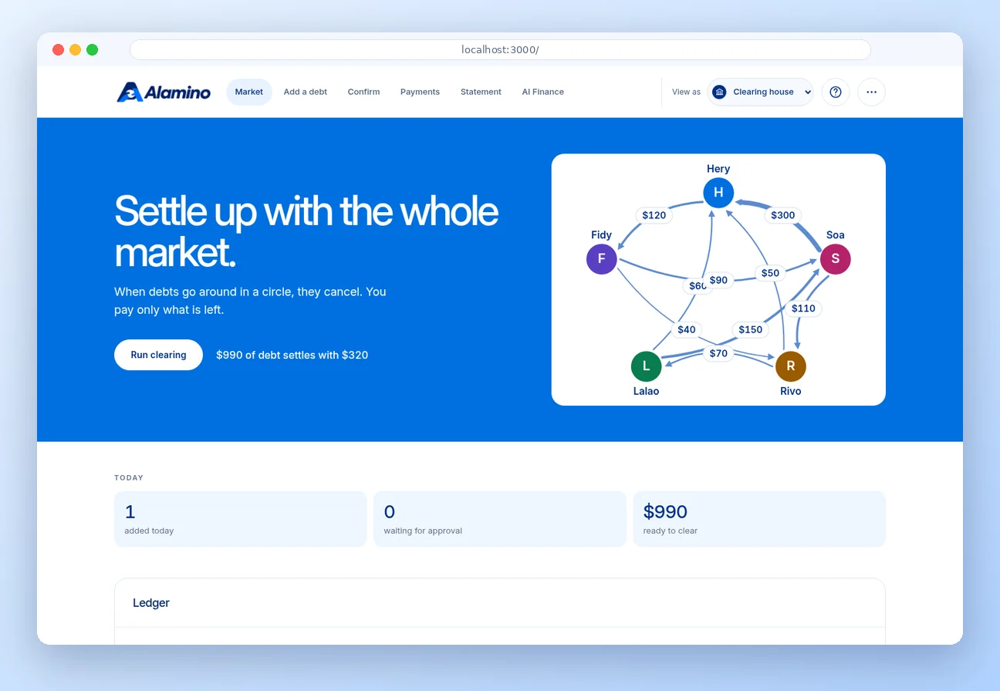

### Add a debt (`/add`)

A text box and a photo upload. The AI drafts appear as editable cards, then save.

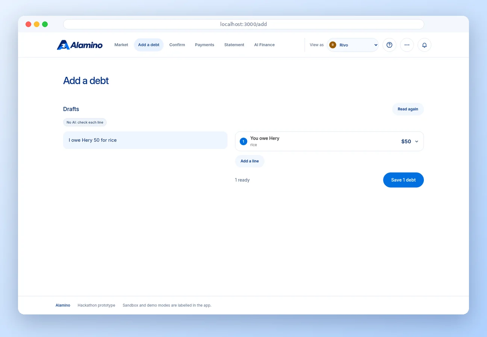

### Confirm (`/confirm`)

Debts waiting for the current trader: approve or counter, with an AI suggestion on disputes.

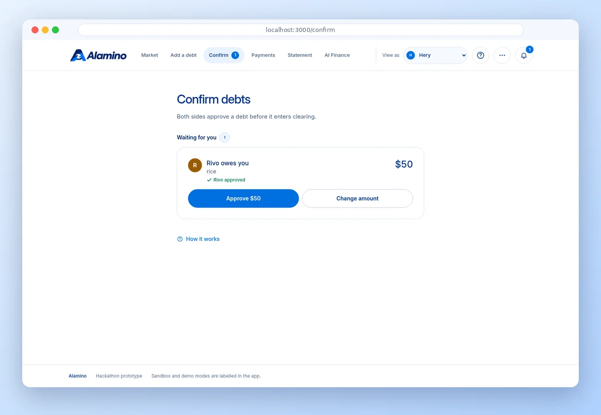

### Round (`/rounds/[id]`)

The before and after network, the circles cancelled, the pay-in buttons and the payout status.

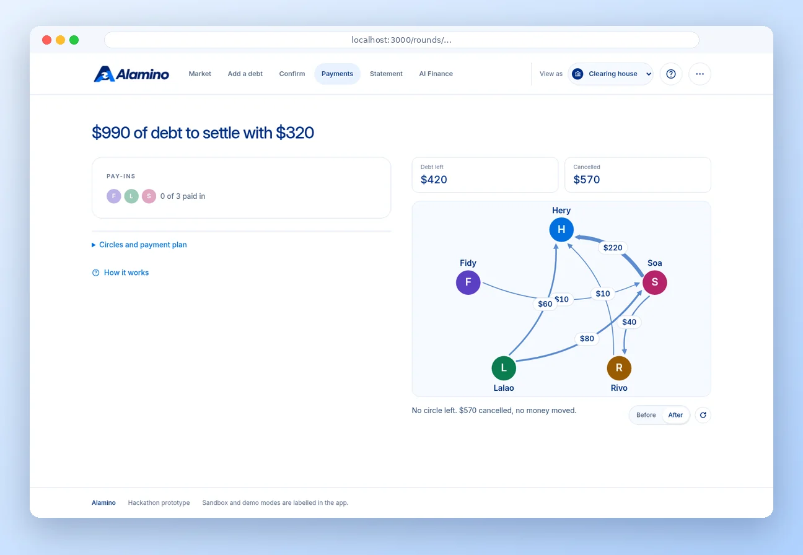

### Statement (`/statement`)

The current trader's statement for the latest round: what cancelled, what is left, and why.

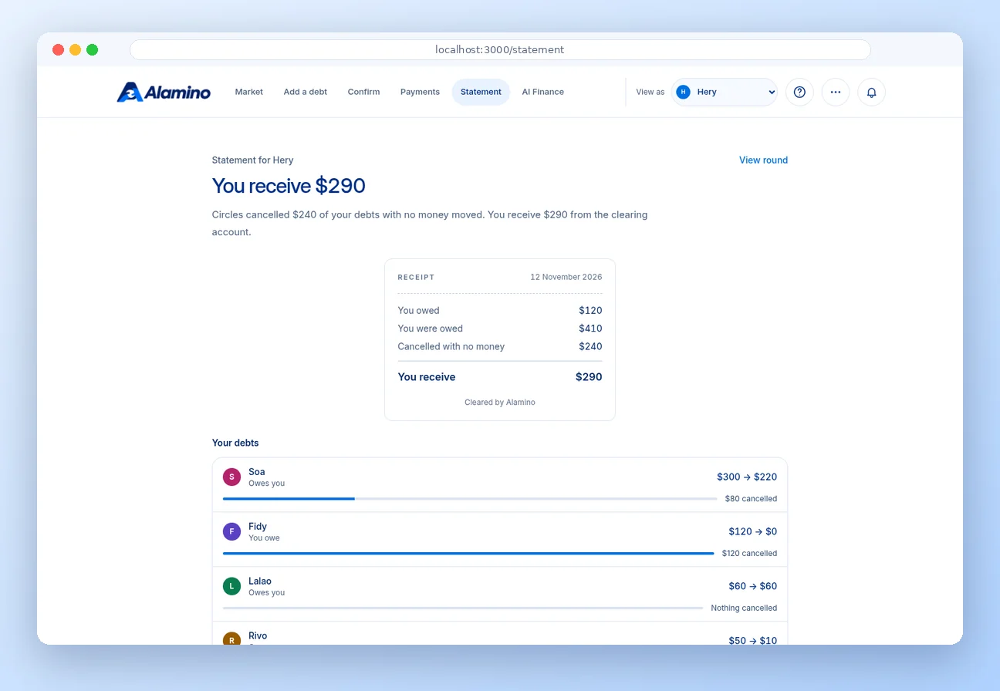

### AI Finance (`/finance`)

The AI finance dashboard: ledger, Sandbox data and the assistant. After the demo round it shows $320.00 received and $320.00 paid out. See the [Finance docs](docs/FINANCE.md).

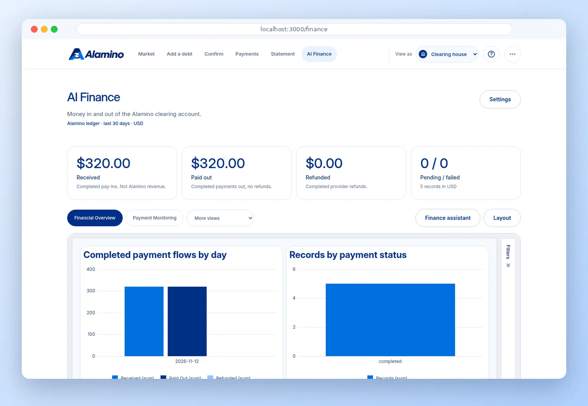

| Route | Shows |
|---|---|
| `/` | Debt network, ledger, headline numbers, Run clearing, reset |
| `/add` | Text box and photo upload, AI drafts as editable cards, save |
| `/confirm` | Debts waiting for the current trader, approve or counter, AI suggestion on disputes |
| `/rounds/[id]` | Before/after network, circles cancelled, pay-in buttons, payout status |
| `/statement` | The current trader's statement for the latest round |
| `/finance` | AI finance dashboard: ledger, Sandbox data, assistant |

## Environment variables

Copy `.env.example` to `.env.local`. Never commit real keys: the repo is public.

| Variable | Purpose | Required? |
|---|---|---|
| `PAYPAL_CLIENT_ID` / `PAYPAL_CLIENT_SECRET` | Sandbox REST app credentials, server side only | No, else simulated payments |
| `NEXT_PUBLIC_PAYPAL_CLIENT_ID` | Same Sandbox app id, for the Checkout button | No, else simulated payments |
| `PAYPAL_BASE_URL` | PayPal API endpoint (`https://api-m.sandbox.paypal.com`) | No, has a default |
| `PAYPAL_EMAIL_HERY` … `PAYPAL_EMAIL_FIDY` | Sandbox personal account of each trader (receives payouts) | Only for real payouts |
| `AI_BASE_URL` / `AI_MODEL` / `AI_API_KEY` | OpenAI-compatible LLM provider and model (defaults in `.env.example`) | No, else plain-code fallback |
| `AI_REASONING_EFFORT` | `minimal`, `low`, `medium` or `high` | No, default `minimal` |
| `AI_DAILY_CALLS` | Max model calls per UTC day | No, default `300` |
| `DATABASE_PATH` | SQLite file, default `./data/app.db` | No, has a default |
| `FINANCE_ADMIN_PASSWORD` | Operator password (16+ chars) for Sandbox payments, account data and live finance AI | Required for real Sandbox actions and Finance admin |
| `NEXT_PUBLIC_AG_STUDIO_LICENSE_KEY` | Browser licence key for AG Studio | No, else trial watermark |

Restart after changing server environment variables. Changes to any `NEXT_PUBLIC_` variable also require a new build: these values are included in the browser bundle. On the VPS, update the private `.env.local` and rerun the main deployment workflow to rebuild with the new public configuration.

## AI tools used to build this project

- **LLM (OpenAI-compatible AI model)**: the AI model the app itself calls for capture, mismatch resolution, statements and the finance assistant.
- **Image generation**: the [logo](public/alamino-logo.png) and the six [guide illustrations](public/illustrations/alamino-guide.webp) were generated with an image tool from written prompts, then optimised to WebP. The guide prompts are kept in the onboarding docs.
- **Codex**: assisted implementation, automated tests, deployment troubleshooting, VPS operations scripts and documentation.

The screenshots and clips in this README are not generated: they are recorded from the running app with Playwright, then framed and converted to WebP and GIF.

## Checks

```sh
npm test            # unit + API tests
npm run typecheck
npm run lint
npm run e2e         # Playwright journeys on a production build, no keys, own database
```

`npm run test:e2e:issues` replays the real user path per issue with a screenshot per step. `npm run test:e2e:ui` watches a walk visually in the Playwright UI.

## Docs

- [Automatic VPS deployment, SSH secrets and rollback](docs/DEPLOYMENT.md)
- [Operations: monitoring, scheduled backups, restore checks, retention and logs](docs/OPERATIONS.md)
- [Devpost submission text and team review checklist](docs/DEVPOST.md)
- [First-visit tour, illustrated guides and navigation](docs/ONBOARDING.md)
- [AI Finance Dashboard: setup, Sandbox, AG Studio and validation](docs/FINANCE.md)
- [Architecture](docs/ARCHITECTURE.md)
- [Overall flow diagram](docs/clearing-house-system.md)
- [User journeys, sequence diagrams](docs/user-journeys.md)

## Contributors

<table>
  <tr>
    <td align="center" width="180">
      <a href="https://github.com/donovan-ratefison">
        <br>
        <strong>Donovan</strong><br>
        <sub>@donovan-ratefison</sub>
      </a>
    </td>
    <td align="center" width="180">
      <a href="https://github.com/Tokiarivelo">
        <br>
        <strong>Tokiarivelo</strong><br>
        <sub>@Tokiarivelo</sub>
      </a>
    </td>
    <td align="center" width="180">
      <a href="https://github.com/TsilaRH">
        <br>
        <strong>Tendry Tsilavina</strong><br>
        <sub>@TsilaRH</sub>
      </a>
    </td>
  </tr>
</table>

## Licence

Apache 2.0. See [LICENSE](LICENSE).
