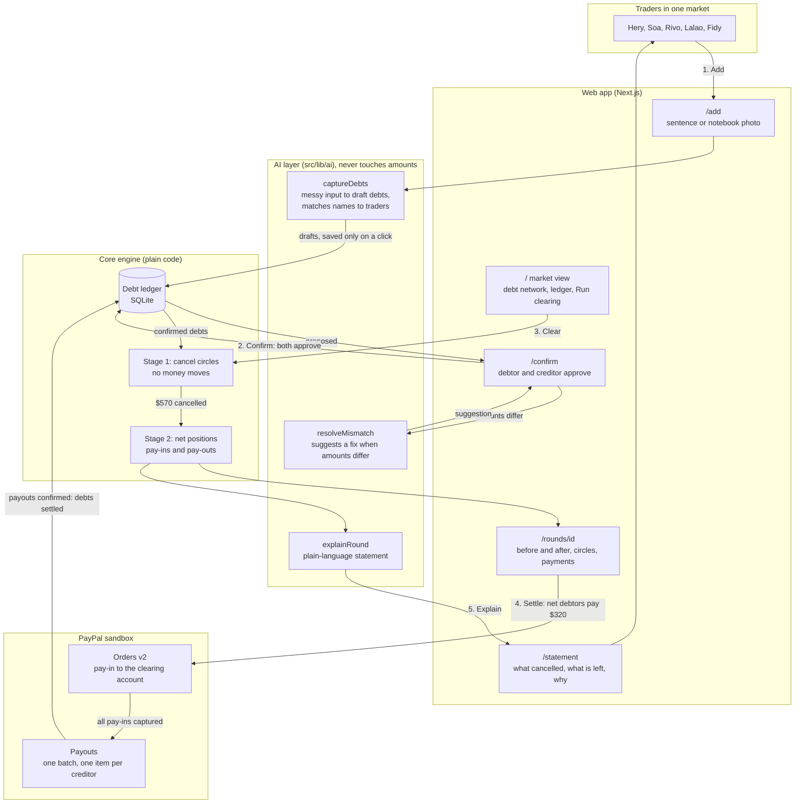

# Alamino: overall flow

## How to read it

- **Five steps.** Add, confirm, clear, settle, explain. The numbers on the arrows follow `ARCHITECTURE.md`, section 1.
- **Money decisions stay in plain code.** The AI reads messy input, suggests and explains. The ledger, the netting and the settlement plan are deterministic.
- **Cash moves once.** Circles cancel $570 of the $990 with no money. Net debtors pay $320 into the clearing account (Orders v2). The clearing account pays the net creditors (Payouts).
- **No payout before all pay-ins are captured.** Capture and payout are idempotent.
- **Without keys the demo still runs.** PayPal runs in simulated mode and the AI uses a plain-code fallback. The UI labels both.
