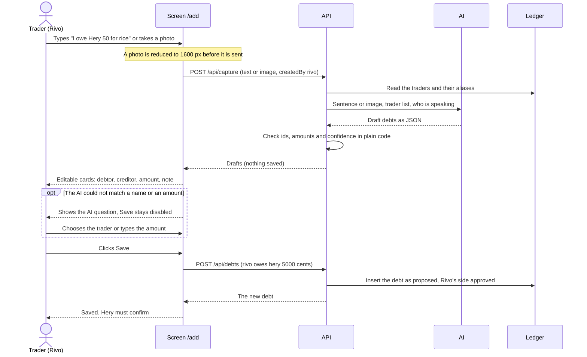
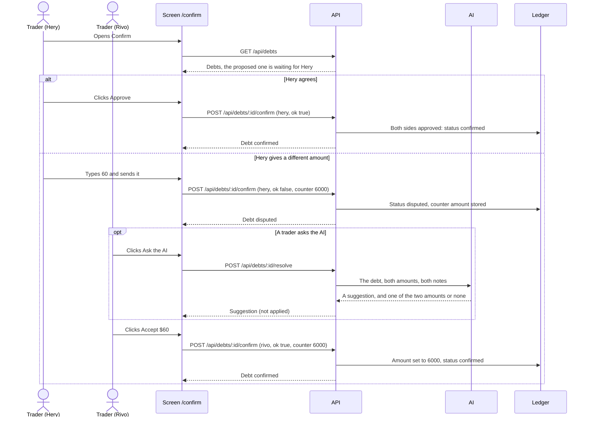
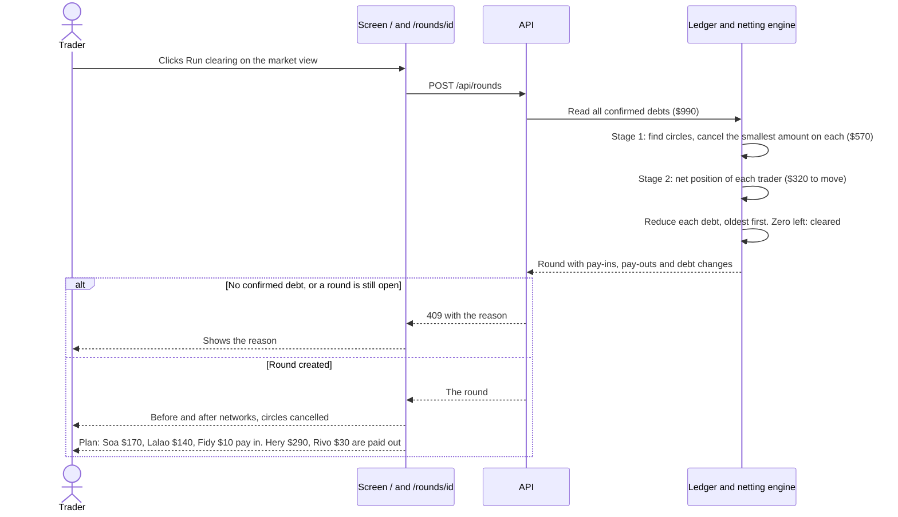
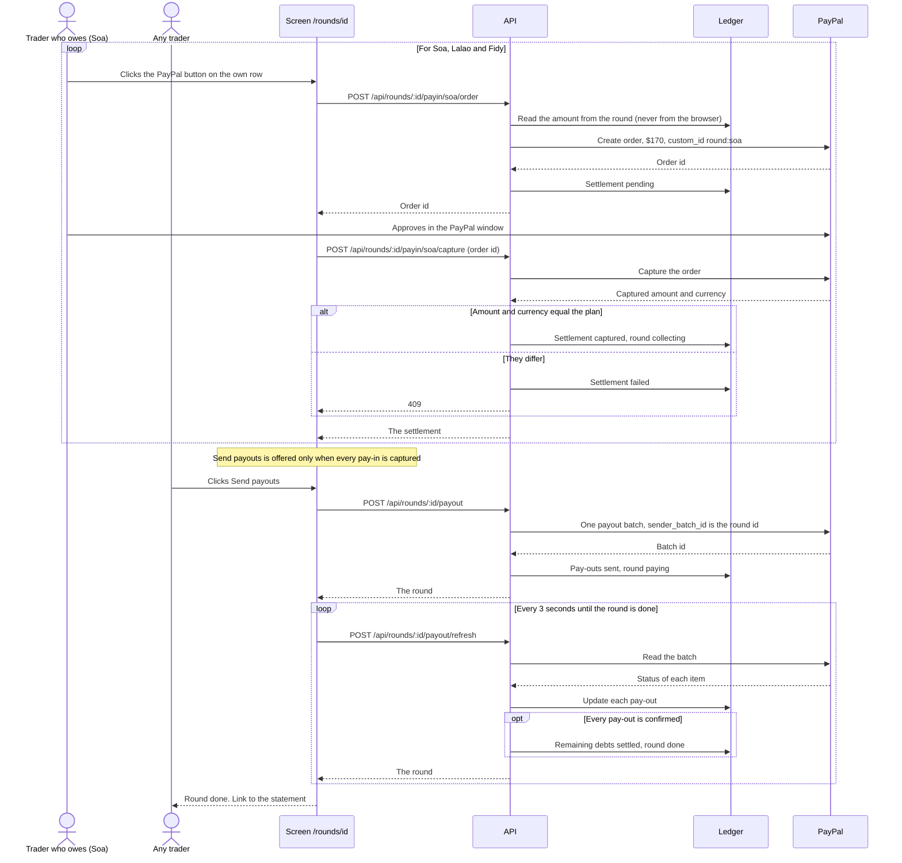
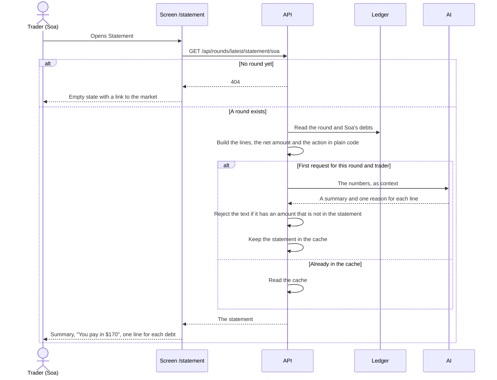
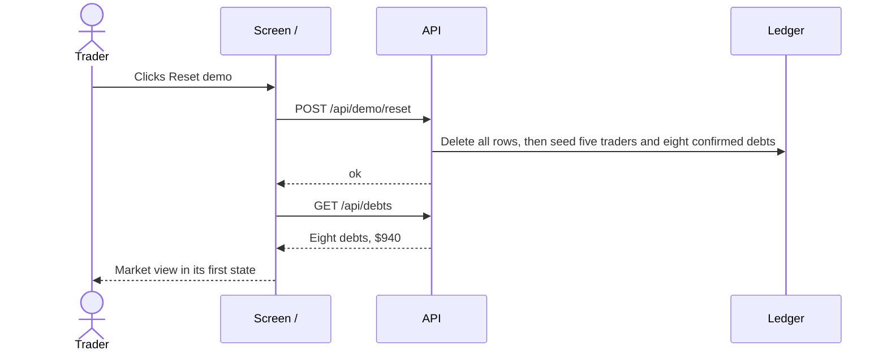

# User journeys

Sequence diagrams of the six user journeys. The amounts are those of the demo data (`ARCHITECTURE.md`, section 11). The automated tests in `e2e/` follow the same journeys.

Participants:

- **Trader**: the person in front of the screen. The "View as" select in the header chooses which trader.
- **Screen**: the page in the browser.
- **API**: the Next.js route handlers.
- **AI**: the model behind `src/lib/ai`. It never computes or changes an amount.
- **Ledger**: the SQLite database and the netting engine (plain code).
- **PayPal**: the sandbox. Without keys, the API simulates it and the screen says so.

## 1. Add a debt

A trader types a sentence or takes a photo of a notebook page. Nothing is saved before the trader clicks Save.

## 2. Confirm a debt

The other side approves, or gives a different amount. The AI can suggest a way out of a dispute, but both sides must still approve.

## 3. Run clearing

The engine cancels the circles, then works out who pays in and who is paid out. No money moves in this journey.

## 4. Settle through PayPal

Each trader who owes pays in to the clearing account. When every pay-in is captured, the clearing account pays the traders who are owed.

## 5. Read the statement

Each trader reads what cancelled, what is left and why. The amounts come from the engine. The AI writes only the sentences.

## 6. Reset the demo

